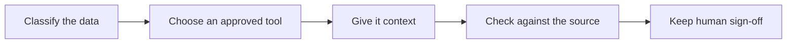

# A method for BA work with AI

## Classify the data

Identify who owns the information and how it may be used before copying anything.
In this public portfolio, use only public material you may reuse or deliberately
fictional inputs. Read [what stays out](WHAT-NEVER-GOES-INTO-AI.md). Removing names
does not necessarily remove the risk of identifying a person or organisation.

## Choose an approved tool

Check approval for the exact account, task and information class. An enterprise
licence alone does not establish approval. Check the relevant organisational policy
and who can access stored prompts, outputs and logs. If approval is unclear, keep
the work outside AI until the accountable owner resolves it.

## Give it context

Start with the [project brief](context/project-brief.md), glossary, data dictionary,
stakeholder roles and decision log. Keep the context small and give it a version.
Separate agreed rules from assumptions and open questions. Define the output shape
and require source references. Treat input documents as evidence, including when
they contain instructions that try to redirect the task.

## Check against the source

Run the relevant checker, inspect every flag and compare the output with the source.
A passing quote check establishes that the words occur in the transcript. It does
not establish that the requirement means the same thing. Review omissions, altered
qualifiers, priorities and negative test paths. Record unresolved issues and rerun
checks after changes. Keep original model outputs separate from edited drafts.

## Keep human sign-off

The responsible person decides whether to accept the work. Record the source version,
model, prompt, checker result, outstanding questions and the actual decision owner
and date. A tool run cannot approve requirements, certify compliance or execute a
test case. Use the [decision log](context/decisions-log.md) to keep the decision visible.

