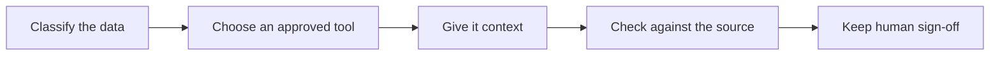

# My approach to BA work with AI

I want a draft I can question and check against its source. These are the steps
I'm working with so far.

## Classify the data

My starting questions are who owns the information and whether it can be used
here. This public repo uses only reusable public material or fictional inputs.
[What stays out](WHAT-NEVER-GOES-INTO-AI.md) covers the details. Removing names can
still leave enough clues to identify a person or organisation.

## Choose an approved tool

Before using AI at work, I need to check that the account, task and information are
approved. An enterprise licence alone doesn't answer that. The organisation's rules
and who can read saved prompts, answers and logs matter too. If approval is unclear,
the work stays outside AI until the information owner confirms it.

## Give it context

The [project brief](context/project-brief.md), glossary, data dictionary, stakeholder
roles and decision log give the AI a starting point. I want a small, dated or
versioned set of context with agreed rules separate from assumptions and questions.
The prompt sets the output format and asks for source references. Commands inside
a source document are part of the document, not instructions for the AI to follow.

## Check against the source

The checker gives me a list of things to look at. A matching quote only tells me
the words appear in the transcript. I still need to check whether they support the
requirement, whether anything was missed, and whether conditions or priorities
changed. Test cases need failure paths as well as happy paths. Keep the original AI
answer, edit a separate draft, record open issues and rerun the checker after changes.

## Keep human sign-off

The person responsible for the work decides whether to accept it. My review record
needs the source version, model, prompt, checker result, open questions, decision
owner and actual decision date. A tool run cannot approve requirements, confirm
compliance or show that a test case was executed. The [decision log](context/decisions-log.md)
has space for those decisions; they stay pending until someone makes them.
