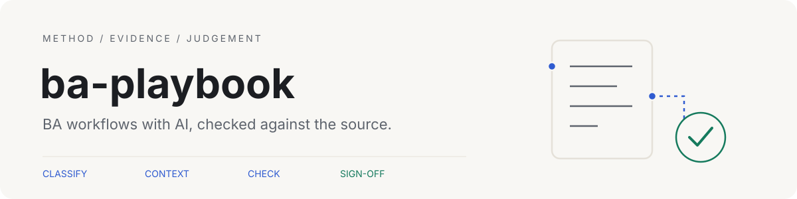
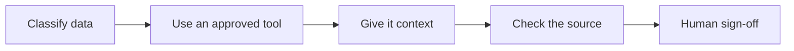

<picture>
  <source media="(prefers-color-scheme: dark)" srcset="assets/banner-dark.svg">
  
</picture>

I want to use AI on BA work without it quietly making things up. This is the
approach I'm putting together for Claude Code, Copilot and ChatGPT, with small
checks for missing quotes, made-up section references and gaps in test links.

## Where I'm up to

The workflows cover workshop notes, specification reviews and acceptance tests.
I haven't recorded a reviewed example yet. My next step is to save a real AI draft,
mark my corrections and explain my sign-off. The [worked example steps](docs/SETUP.md#record-a-worked-example)
show what I'll need to keep.

## My approach



I start with [what never goes into AI](WHAT-NEVER-GOES-INTO-AI.md) and the
[method](METHOD.md). The [context templates](context/) separate agreed rules from
assumptions and open questions. For practice, the workflows use Paper Lantern
Community Clinic, a fictional booking and referral service.

## What the AI does / What checks it

<!-- CHECKS:START -->
| What the AI does | What checks it |
| --- | --- |
| Drafts requirements | [quote-check](checks/quote_check.py): Matches quotes to the source. A person checks meaning and omissions. |
| Reviews a specification | [review-check](checks/review_check.py): Checks section IDs and repeated findings. A person checks the combined review. |
| Writes test cases | [trace-check](checks/trace_check.py): Checks requirement links and complete steps. A person checks what each test covers. |
| Produces a draft for discussion | A person makes the final decision in every workflow. |
<!-- CHECKS:END -->

The checkers use a [simple Markdown format](checks/README.md). A real quote can
still be attached to the wrong requirement. I still need to read the source,
check what was missed and keep the final decision with a person.

## How to run it

The [setup guide](docs/SETUP.md#how-to-run-it) covers choosing an AI tool, saving a
draft, checking it and running the checker self-tests. Each workflow has its own
prompt and checker command:

- [Workshop to requirements](workflows/workshop-to-requirements/README.md): keep each requirement linked to the discussion.
- [Specification review](workflows/spec-review-board/README.md): compare concerns from different roles.
- [Requirements to tests](workflows/requirements-to-tests/README.md): see missing links and incomplete test steps.

## Under the hood

```text
context/                     Project brief, glossary and decision templates
workflows/                   Prompts and fictional source documents
.claude/, .github/ and chat/  Instructions for each AI tool
checks/                      Scripts that check drafts
llm.py and playbook/         Scripts for running workflows and saving results
```

### Data

All clinic inputs were written for this repo. They are fictional practice material,
with no employer, client or patient records. The original code and documents use
the [MIT licence](LICENSE).

## About this repo

This first version was built with AI coding assistants. The results come from the code in this repo.
