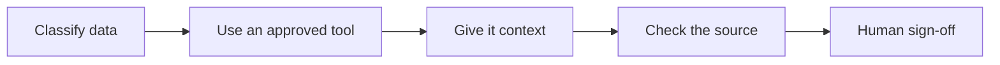

<picture>
  <source media="(prefers-color-scheme: dark)" srcset="assets/banner-dark.svg">
  
</picture>

## The problem

AI can draft a tidy requirement that was never agreed, cite a section that does not
exist or miss a test link. This playbook gives a business analyst a repeatable method
for using AI and small checks that make those mistakes visible.

## The method



Start with [what never goes into AI](WHAT-NEVER-GOES-INTO-AI.md) and the [method](METHOD.md).
Use permitted information in the [context templates](context/) and keep open decisions
visible. The fictional Paper Lantern Community Clinic case covers booking and referral
administration. Keep the original AI draft and checker report for a person to assess
against the source and sign off.
<!-- TIANA: Read METHOD.md and confirm this is the working method you want to discuss, without claiming prior use of these workflows. -->

## Worked example

**Pending.** A real run on the fictional clinic case will show the AI's original
draft, Tiana's corrections and reasons, and her actual sign-off. No such run or
review is recorded yet. Follow the [steps for recording a worked example](docs/SETUP.md#record-a-worked-example).
<!-- TIANA: run one workflow for real, mark up your corrections, record your sign-off, then replace this section with the real example -->

## What the AI does / What checks it

<!-- CHECKS:START -->
| What the AI does | What checks it |
| --- | --- |
| Drafts requirements | [quote-check](checks/quote_check.py): Verbatim source check, then a person checks meaning and omissions. |
| Reviews a specification | [review-check](checks/review_check.py): Section citations and repeated issue text, then a person checks the consolidation. |
| Writes test cases | [trace-check](checks/trace_check.py): Requirement links and complete steps, then a person checks behaviour and coverage. |
| Produces a draft for discussion | A person retains final sign-off on every workflow. |
<!-- CHECKS:END -->

The checkers use a [small Markdown contract](checks/README.md). A pass confirms only
the checks described there. A person decides whether the work is accurate and useful.

## Checker self-tests

<!-- RESULTS:START -->
The checkers caught **13 of 13 planted structural issues** across **12 fixture documents**. They flagged **0 of 6 good documents**.

| Checker | Planted | Caught | Missed | Unexpected flags | Good documents flagged |
| --- | ---: | ---: | ---: | ---: | ---: |
| Quote | 4 | 4 | 0 | 0 | 0 / 2 |
| Review | 3 | 3 | 0 | 0 | 0 / 2 |
| Trace | 6 | 6 | 0 | 0 | 0 / 2 |

These small, hand-authored fixtures exercise known structural defects. This is not evidence of model accuracy or real-world detection rates. A quote can be real but irrelevant, a cited section can be misread, and a linked test can miss the behaviour.

Measured using [labelled fixtures](tests/fixtures/README.md). [Run details](results/checker-benchmark.json) include expected and actual issue IDs and input hashes; [setup instructions](docs/SETUP.md#reproduce-the-checker-self-tests) explain how to reproduce them.
<!-- RESULTS:END -->

## Use it in your own tools

Follow the [setup guide](docs/SETUP.md) to use these workflows in Claude Code, Copilot or an approved chat app.
<!-- TIANA: Open the repo in your installed Claude Code and VS Code Copilot, confirm the skills and reviewer agents load, and record any version-specific differences. -->

## Under the hood

```text
METHOD.md and WHAT-NEVER-GOES-INTO-AI.md  Method and information handling
context/                                  Empty project context templates
workflows/                                Prompts, fictional inputs and runner guide
.claude/, .github/ and chat/              Tool entry points and automated checks
checks/                                   Standalone Markdown checkers
llm.py and playbook/                      Model runner and self-test generator
tests/ and results/                       Labelled fixtures and measured counts
docs/SETUP.md                             Setup and worked example steps
assets/                                   Light and dark banners
```

Commands for setup, self-tests and model runs are in [SETUP.md](docs/SETUP.md).

### Data

All clinic inputs were written for this repo and are explicitly fictional. They
are input exercises, not records of a real workshop or model outputs. Synthetic
checker fixtures live only in [tests/fixtures](tests/fixtures/). The repository's
original code, documents and fictional material use the [MIT licence](LICENSE).
No external dataset or raw-data download is needed.

The [Australian Government staff guidance](https://www.digital.gov.au/policy/ai/staff-guidance-public-generative-ai)
is linked as further reading. It is not copied into the repo or used as legal advice.
<!-- TIANA: Check the information-handling guide against current official guidance and any policy governing your intended use. Do not present it as legal or clinical advice. -->

## About this repo

This repo was built with AI coding assistants. Reported checker results come from
code and labelled fixtures in this repository; the worked example and human sign-off
remain pending.
<!-- TIANA: in your own words, say what you designed, what you checked and what the AI built -->
