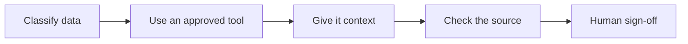
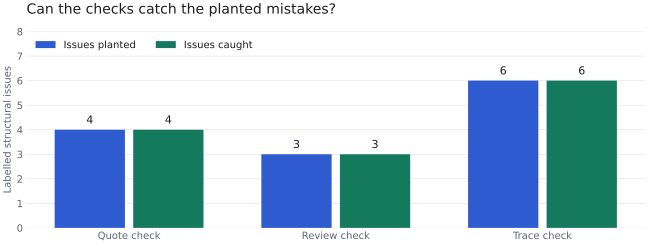

<picture>
  <source media="(prefers-color-scheme: dark)" srcset="assets/banner-dark.svg">
  
</picture>

AI can draft a tidy requirement that was never agreed, cite a section that does not
exist or miss a test link. This playbook gives a business analyst a repeatable method
for using AI and small checks that make those mistakes visible.



Start with [what never goes into AI](WHAT-NEVER-GOES-INTO-AI.md) and the [method](METHOD.md).
<!-- TIANA: Read METHOD.md and confirm this is the working method you want to discuss, without claiming prior use of these workflows. -->

## Results

<!-- RESULTS:START -->
The checkers caught **13 of 13 planted structural issues** across **12 fixture documents**. They flagged **0 of 6 good documents**.

| Checker | Planted | Caught | Missed | Unexpected flags | Good documents flagged |
| --- | ---: | ---: | ---: | ---: | ---: |
| Quote | 4 | 4 | 0 | 0 | 0 / 2 |
| Review | 3 | 3 | 0 | 0 | 0 / 2 |
| Trace | 6 | 6 | 0 | 0 | 0 / 2 |

<picture>
  <source media="(prefers-color-scheme: dark)" srcset="assets/checker-benchmark-dark.svg">
  
</picture>

Measured by `make results` using [labelled fixtures](tests/fixtures/README.md). [Run details](results/checker-benchmark.json) include expected and actual issue IDs and input hashes.

These small, hand-authored fixtures exercise known structural defects. This is not evidence of model accuracy or real-world detection rates. A quote can be real but irrelevant, a cited section can be misread, and a linked test can miss the behaviour.
<!-- RESULTS:END -->

**Examples pending.** The prompts, model backends and checkers are ready. No model
examples were generated during the build. To prepare manual prompts, replace the
model label below with the one shown by your approved chat app:

```sh
make examples BACKEND=manual MODEL="your-chat-model" RUN=first-run
```

Paste each saved prompt, save the real answers to the printed paths, then rerun the
same command. The review board needs a further consolidation pass. An API or
Claude Code run uses the same target with its backend and model ID. See the
[runner guide](workflows/README.md) for keys, resuming and failure states.
<!-- TIANA: Run real examples in an approved tool, inspect the sources and every output, resolve checker findings and record the actual review and sign-off before publishing any example as accepted. -->

## How it works

The diagram above is the sequence for every workflow. Fill in the [context templates](context/)
with permitted information and keep open decisions visible. The fictional Paper
Lantern Community Clinic case covers booking and referral administration. The AI
drafts Markdown, then Python checks quotations, section citations or requirement
links. Keep the original output and checker report for a person to assess and sign off.

## The same workflow in three tools

<!-- TOOLS:START -->
| Workflow | Claude Code skill | Copilot prompt | Chat instructions |
| --- | --- | --- | --- |
| [workshop-to-requirements](workflows/workshop-to-requirements/README.md) | [SKILL.md](.claude/skills/workshop-to-requirements/SKILL.md) | [prompt.md](.github/prompts/workshop-to-requirements.prompt.md) | [Paste guide](chat/workshop-to-requirements.md) |
| [spec-review-board](workflows/spec-review-board/README.md) | [SKILL.md](.claude/skills/spec-review-board/SKILL.md) | [prompt.md](.github/prompts/spec-review-board.prompt.md) | [Paste guide](chat/spec-review-board.md) |
| [requirements-to-tests](workflows/requirements-to-tests/README.md) | [SKILL.md](.claude/skills/requirements-to-tests/SKILL.md) | [prompt.md](.github/prompts/requirements-to-tests.prompt.md) | [Paste guide](chat/requirements-to-tests.md) |
<!-- TOOLS:END -->

Copilot prompt files work in VS Code's Local agent. Agent Host sessions use the
included [.github/skills](.github/skills/) wrappers. Both use the same workflow
instructions. See the [official compatibility note](https://code.visualstudio.com/docs/agent-customization/prompt-files).
<!-- TIANA: Open the repo in your installed Claude Code and VS Code Copilot, confirm the skills and reviewer agents load, and record any version-specific differences. -->

## What the AI does / What checks it

<!-- CHECKS:START -->
| What the AI does | What checks it |
| --- | --- |
| Drafts requirements | [quote-check](checks/quote_check.py): Verbatim source check, then a person checks meaning and omissions. |
| Reviews a specification | [review-check](checks/review_check.py): Section citations and repeated issue text, then a person checks the consolidation. |
| Writes test cases | [trace-check](checks/trace_check.py): Requirement links and complete steps, then a person checks behaviour and coverage. |
| Produces a draft for discussion | A person retains final sign-off on every workflow. |
<!-- CHECKS:END -->

The checkers use a [small Markdown contract](checks/README.md). A pass confirms only
the checks described there. A person decides whether the work is accurate and useful.

## Try it

Install [uv](https://docs.astral.sh/uv/getting-started/installation/) and Python 3.11.
Run these commands from a local copy of this repository. No model account is needed.

```sh
make setup
make results
uv run pytest
```

## Data

All clinic inputs were written for this repo and are explicitly fictional. They
are input exercises, not records of a real workshop or model outputs. Synthetic
checker fixtures live only in [tests/fixtures](tests/fixtures/). The repository's
original code, documents and fictional material use the [MIT licence](LICENSE).
No external dataset or raw-data download is needed.

The [Australian Government staff guidance](https://www.digital.gov.au/policy/ai/staff-guidance-public-generative-ai)
is linked as further reading. It is not copied into the repo or used as legal advice.
<!-- TIANA: Check the information-handling guide against current official guidance and any policy governing your intended use. Do not present it as legal or clinical advice. -->

## Repo layout

```text
METHOD.md                      The working method
WHAT-NEVER-GOES-INTO-AI.md       Practical information-handling guide
context/                       Empty project context templates
workflows/                     Prompts, fictional inputs and runner guide
.claude/                       Claude Code skills and reviewer agents
.github/                       Copilot packaging and automated checks
chat/                          Instructions for any approved chat app
checks/                        Standalone Markdown checkers
llm.py                         Optional model backends and provenance
playbook/                      Example runner and benchmark generator
tests/                         Offline tests and labelled fixtures
results/                       Reproducible benchmark details
assets/                        Light and dark banners and charts
```

## About this repo

Built with AI coding assistants. Reported checker results come from code and labelled
fixtures in this repository; model examples and human acceptance remain pending.

